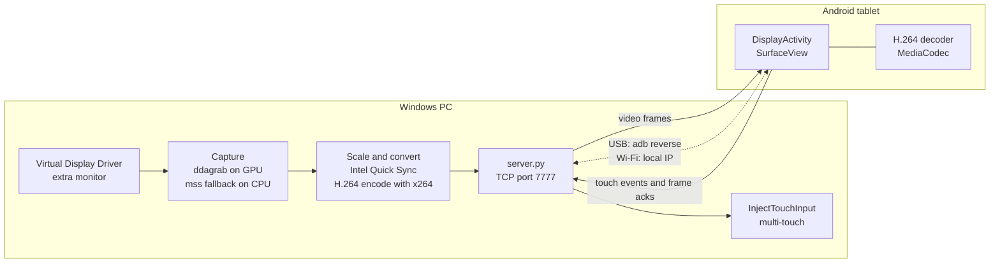

# Segunda Tela (Second Screen)

> Read this in [Portuguese](README.pt-BR.md).

**Turn an Android tablet into an extended Windows display, with real multi-touch, over USB or Wi-Fi.**

Segunda Tela streams your Windows desktop to an Android tablet and sends the tablet's touches back to the PC as real Windows touch input: tap, drag, pinch, two-finger scroll and press-and-hold.

   

## Highlights

- **Extended desktop, not a mirror.** Windows sees a real monitor, created by the [Virtual Display Driver](https://github.com/VirtualDrivers/Virtual-Display-Driver) (MIT). It appears only while the tablet is connected.
- **Real touch.** Touches are injected with the Windows `InjectTouchInput` API, so multi-touch gestures work in any app. If touch injection is unavailable, the first finger falls back to the mouse.
- **Smooth video.** H.264 at up to 60 frames per second. The tablet decodes the stream with its hardware decoder (Android `MediaCodec`).
- **USB or Wi-Fi.** Over USB the PC and tablet talk through `adb reverse`, and the app opens on the tablet automatically.
- **Flow control.** The tablet acknowledges each frame it draws, and the PC keeps only a few frames in flight. This prevents latency from building up.
- **Small footprint.** The Android app has no third-party dependencies. The PC side is one Python server plus a small Tkinter panel, and it can be packaged as a single `.exe`.

## How it works



1. **Virtual monitor.** Windows gets an extra display from the Virtual Display Driver, sized to the tablet's resolution at 60 Hz.
2. **Capture.** `server.py` captures that monitor through FFmpeg's `ddagrab` filter, running on the GPU. If the GPU path is unavailable, it falls back to CPU capture with `mss`. The mouse cursor is drawn into the frame.
3. **Encode.** Intel Quick Sync (`vpp_qsv`) converts the frame to NV12 at the video size. `libx264` (ultrafast, zero-latency preset) encodes it as H.264.
4. **Transport.** The PC sends a header (`"H264"`, width, height), then each frame as `[int32 length][H.264 Annex B data]`.
5. **Decode and show.** The tablet decodes each frame with `MediaCodec` onto a full-screen `SurfaceView`, then sends an acknowledgment.
6. **Touch back to Windows.** Each touch event (`[action | finger << 4][float x][float y]`, with x and y normalized from 0 to 1) is mapped to the monitor's pixels and injected as a Windows touch.

### Wire protocol (TCP, big-endian)

| Direction | Message |
|---|---|
| PC → tablet | `"H264"`, then `int32` width and `int32` height; then repeated `[int32 size][H.264 frame]` |
| Tablet → PC | repeated `[byte action \| finger << 4][float x][float y]`; actions: 0 down, 1 move, 2 up, 3 frame shown (flow control) |

## Repository layout

| Path | Purpose |
|---|---|
| `pc/server.py` | Capture, H.264 encoding, touch injection, and monitor on/off control |
| `pc/gui.py` | Desktop control panel (Tkinter) |
| `pc/setup-monitor.ps1` | One-time setup of the virtual monitor (runs as administrator) |
| `pc/test_server.py` | Tests: `python pc/test_server.py` |
| `android/` | Android app (Kotlin, no third-party dependencies) |
| `release/SegundaTela.apk` | Prebuilt Android app |
| `Instalar.bat` / `instalar.ps1` | Guided installer: Python, dependencies, `adb`, APK, desktop shortcut |
| `Montar-EXE.bat` / `montar-exe.ps1` | Builds a standalone `SegundaTela.exe` with PyInstaller |
| `tools/icons.py` | Generates the app icons |

## Setup

### Requirements

- Windows 10 or 11. GPU capture is designed for Intel graphics (DXGI and Quick Sync). Other GPUs use CPU capture, which is slower.
- An Android tablet running Android 8.0 or newer, with USB debugging enabled.
- Python 3.10+ (the installer can install it with `winget`).

### Install

1. Download the repository (**Code > Download ZIP**) and extract it.
2. Double-click **`Instalar.bat`**. It checks Python, installs the PC dependencies from `pc/requirements.txt`, downloads Google's official `adb` if needed, installs the APK on the tablet over USB, and creates a desktop shortcut.
3. Open **Segunda Tela** and click **Ativar monitor do tablet** (Activate tablet monitor) once. Windows asks for administrator permission. This downloads the Virtual Display Driver from its official release page, verifies its SHA256 hash, installs it, and creates two scheduled tasks (`\SegundaTela\LigarMonitor` and `\SegundaTela\DesligarMonitor`) that turn the monitor on and off without a password prompt.
4. Click **Iniciar** (Start). In USB mode, the app opens on the tablet automatically.

### On the tablet

Enable **USB debugging**: Settings → About → tap "Build number" seven times → Developer options → USB debugging. On Xiaomi/MIUI devices, also enable "Install via USB".

### Wi-Fi mode

Choose **Wi-Fi** in the panel and enter the IP address shown on the PC into the tablet app.

> **Security note:** Wi-Fi mode has no password. Anyone on the same network can view the screen and send touches. Use it only on trusted networks. USB mode accepts connections only from the cable (`127.0.0.1`).

## Build from source

- **Android app** (JDK 17+ and Android SDK): `cd android`, then `gradlew.bat assembleDebug`. The APK is written to `android/app/build/outputs/apk/debug/`.
- **Windows executable** (optional): run `Montar-EXE.bat`. It installs PyInstaller, runs the tests, and produces `dist/SegundaTela.exe`, which bundles the panel, FFmpeg, and the setup script.

## Uninstall

```bat
schtasks /delete /tn \SegundaTela\LigarMonitor /f
schtasks /delete /tn \SegundaTela\DesligarMonitor /f
```

Then uninstall **Virtual Display Driver** in Device Manager, and delete the shortcut, `%LOCALAPPDATA%\SegundaTela`, and `%ProgramData%\SegundaTela`.

## Credits

- [Virtual Display Driver](https://github.com/VirtualDrivers/Virtual-Display-Driver) (MIT), which provides the virtual monitor. It is downloaded from its official page and is not included in this repository.
- FFmpeg, x264, `mss`, Pillow, NumPy, and PyAV for capture and encoding.

## License

MIT. See [LICENSE](LICENSE).
